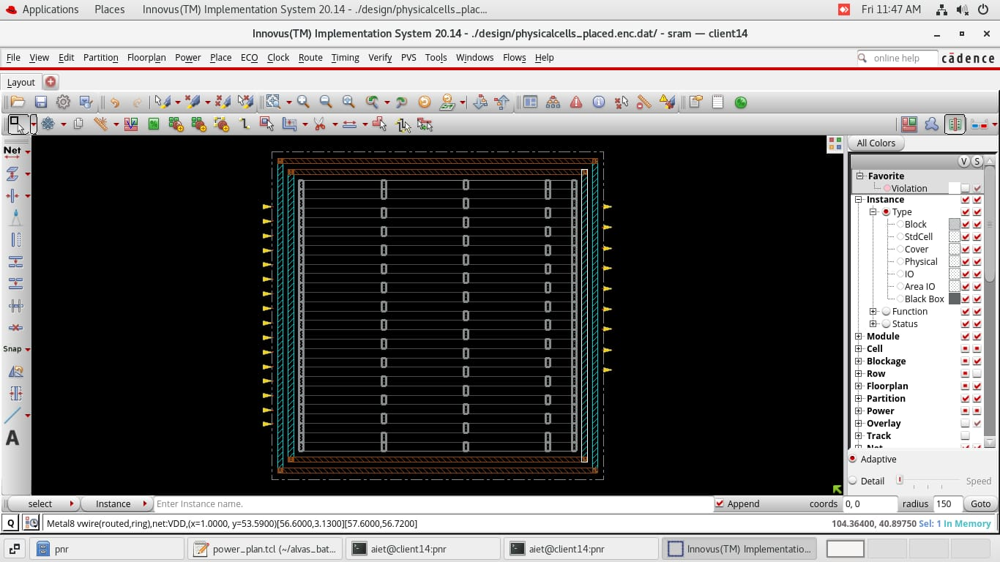
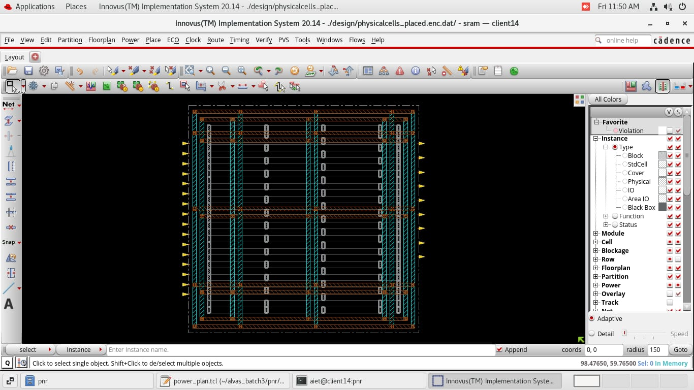
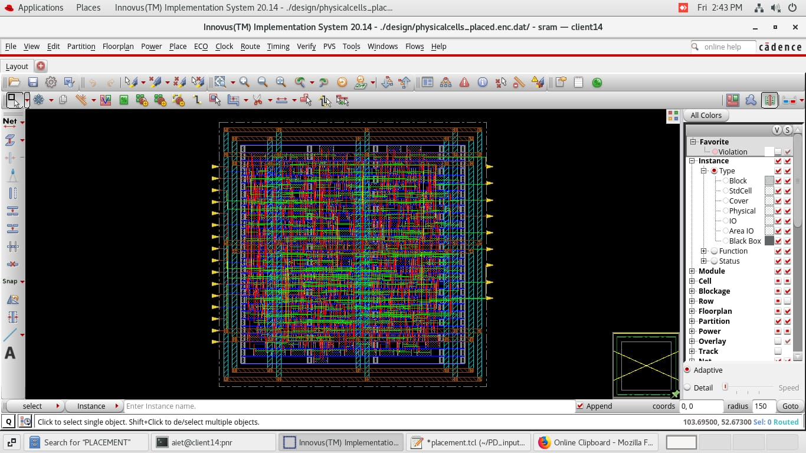
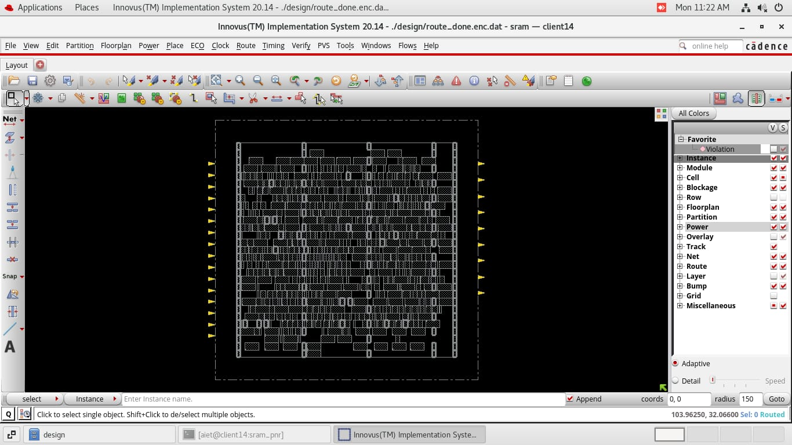
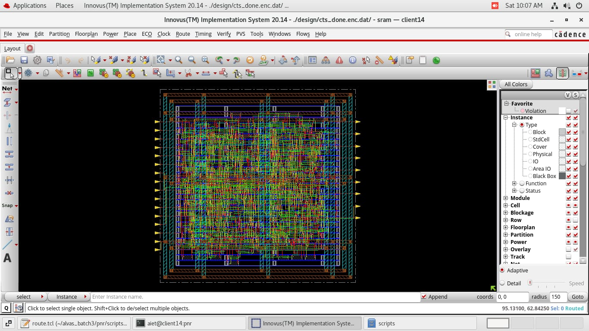
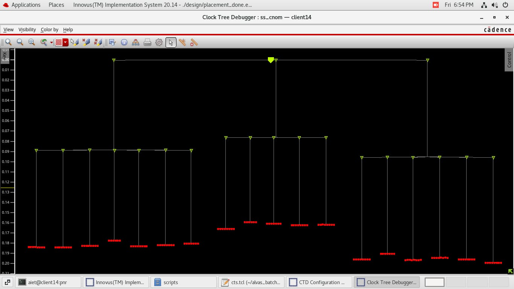
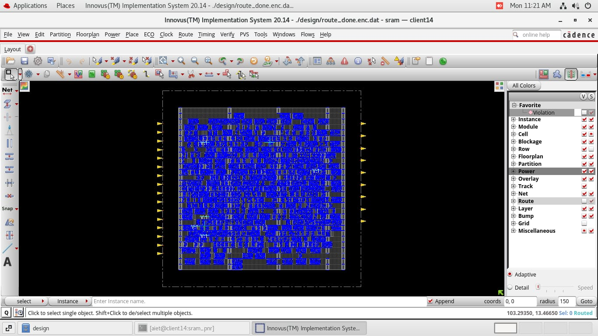
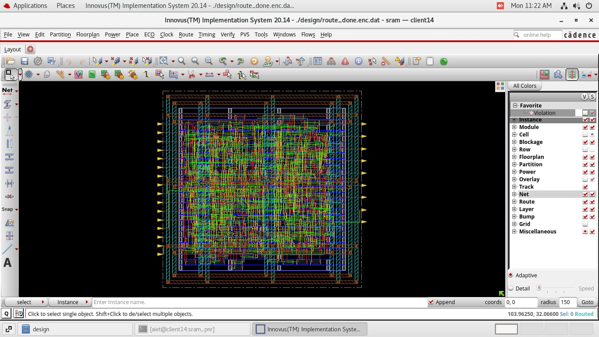
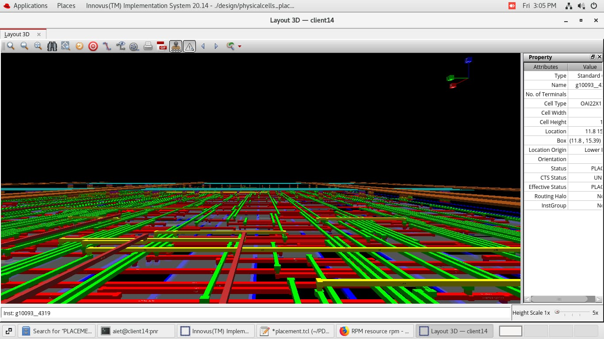

# ASIC Physical Design of 45nm SRAM Controller (Netlist-to-GDSII)


-green)


This repository contains the complete **ASIC Physical Design (Place and Route - PnR)** implementation of an **8-bit $\times$ 16-word SRAM Controller (`sram`)** using **Cadence Innovus Implementation System (v20.14)** and a **45nm standard cell PDK (`gsclib045`)**. 

The design flow executes all physical design stages from gate-level netlist import, floorplanning, power grid network design (PG Mesh), standard cell placement, Clock Tree Synthesis (CTS via CCOpt), global/detail routing (NanoRoute), DRC/connectivity verification, up to final **GDSII layout stream-out**.

---

## 📌 Design Specifications & PnR Metrics

| Parameter / Feature | Specification Details |
| :--- | :--- |
| **Top-Level Module** | `sram` (8-bit data width, 4-bit address depth, valid/ready handshaking) |
| **Technology Node** | 45nm CMOS (`gsclib045` standard cell library, HVT & LVT variants) |
| **Synthesis Tool** | Cadence Genus Synthesis Solution (v23.16) |
| **PnR EDA Tool** | Cadence Innovus Implementation System (v20.14) |
| **Target Clock Frequency** | **185.18 MHz** (Clock Period: `5.4 ns`, Waveform: `0.0 ns` to `2.7 ns`) |
| **Core Utilization** | **50% – 55%** |
| **Core Aspect Ratio** | `1.0` (Square core geometry) |
| **Core Margins** | `5 µm` on Left, Right, Top, Bottom |
| **Power Grid Network** | Core PG Rings (Metal8/Metal9), Horizontal Stripes (Metal9), Vertical Stripes (Metal8) |
| **Physical Cells** | Checkerboard WellTap cells (`FILL2`/`FILL4` @ 45µm pitch), EndCap cells (`FILL2`/`FILL4`) |
| **Routing Layers** | Metal1 (Bottom) to Metal7 (Top Routing Layer) |
| **Clock Sinks Insertion Delay** | `~0.16 ns` to `0.20 ns` (Target Skew: `0.1 ns`, Target Max Trans: `0.2 ns`) |
| **Analysis Corners (MMMC)** | **Setup Corner**: `func_ss` (`slow_vdd1v0`) \| **Hold Corner**: `func_ff` (`fast_vdd1v0`/`fast_vdd1v2`) |

---

## 📁 Repository Directory Structure

```
sram-physical-design-45nm/
├── README.md                          # Comprehensive project documentation
├── .gitignore                         # Cadence Innovus log & binary database filter
├── inputs/                            # Design netlist, SDC constraints, and MMMC configs
│   ├── Default.globals                # Innovus global environment & library pointers
│   ├── Default.view                   # MMMC view definitions (Corner setup)
│   ├── memory_netlist.v               # Gate-level Verilog netlist (Cadence Genus output)
│   └── memory_sdc.sdc                 # Synopsys Design Constraints (185 MHz clock)
├── scripts/                           # Modular TCL physical design scripts
│   ├── master_flow.tcl                # Master script to run full PnR flow sequentially
│   ├── floorplan_new.tcl              # Floorplanning, pin assignment & physical cells
│   ├── floorplan.tcl                  # Comprehensive floorplan script with dbGet queries
│   ├── power_plan.tcl                 # VDD/VSS Power rings, stripes, and sroute rails
│   ├── placement.tcl                  # Global/detail placement & pre-CTS timing opt
│   ├── cts.tcl                        # Clock Tree Synthesis (CCOpt), latency & skew opt
│   └── route.tcl                      # NanoRoute global/detail routing & GDSII export
├── images/                            # Innovus GUI snapshots (2D layout, CTD, 3D stack)
│   ├── 01_power_grid_mesh.jpg
│   ├── 02_power_plan_physical_cells.jpg
│   ├── 03_placement_flightlines.jpg
│   ├── 04_cell_row_placement.jpg
│   ├── 05_cts_layout.jpg
│   ├── 06_clock_tree_debugger.jpg
│   ├── 07_routed_layer_density.jpg
│   ├── 08_post_route_cells.jpg
│   ├── 09_top_level_routed_layout.jpg
│   └── 10_3d_interconnect_stack.jpg
└── reports/                           # Quality of Results (QoR) sanity & check reports
    ├── chek_lef.txt                   # Physical LEF library verification report
    ├── netlist_check.txt              # Gate-level netlist connectivity report
    └── pin_check.txt                  # IO pin alignment & overlap check report
```

---

## 🛠️ Step-by-Step Physical Design Flow

### Step 1: Floorplanning & Physical Cell Insertion (`floorplan_new.tcl`)
- Imports the netlist (`memory_netlist.v`), MMMC views (`Default.view`), and technology LEF files (`gsclib045_tech.lef`).
- Initializes core and die area using `floorPlan -r {1 0.5 5 5 5 5}`.
- Constrains input pins to the **Left side** (Metal5) and output pins to the **Right side** (Metal5).
- Inserts **EndCap cells** (`FILL2`) on row edges and **WellTap cells** (`FILL2`) in a checkerboard pattern at a maximum interval of **45 µm**.

### Step 2: Power Planning (`power_plan.tcl`)
- Configures logical power and ground net connections (`globalNetConnect VDD / VSS`).
- Construct core power rings: **Metal8 (Vertical)** and **Metal9 (Horizontal)** with $1\,\mu\text{m}$ width and spacing.
- Generates power grid mesh:
  - **Horizontal Power Stripes**: Metal9, width $1\,\mu\text{m}$, set-to-set distance $20\,\mu\text{m}$.
  - **Vertical Power Stripes**: Metal8, width $1\,\mu\text{m}$, set-to-set distance $20\,\mu\text{m}$.
- Runs `sroute` to connect standard cell `VDD`/`VSS` power pins to the top-level PG grid.

### Step 3: Standard Cell Placement (`placement.tcl`)
- Restricts routing layers from **Metal1 to Metal7**.
- Sets global placement max density to **70%** (`setPlaceMode -place_global_max_density 0.70`).
- Executes coarse global placement, placement optimization, and legalization (`place_design`, `refinePlace`, `place_opt_design`).
- Analyzes 3D routing congestion (`reportCongestion -3d`) and reports pre-CTS timing (`timeDesign -preCTS`).

### Step 4: Clock Tree Synthesis - CTS (`cts.tcl`)
- Configures CCOpt clock tree buffer pools (`CLKBUFX2LVT` to `CLKBUFX16LVT`) and inverter pools (`CLKINVX2LVT` to `CLKINVX12LVT`).
- Targets: `max_fanout` = 8, `target_max_trans` = 0.2 ns, `target_skew` = 0.1 ns, `target_insertion_delay` = 0.2 ns.
- Runs `clock_opt_design` / `ccopt_design` to build low-skew clock trees.
- Validates latency and skew using `report_clock_timing` and performs post-CTS timing/hold optimization (`optDesign -postCTS -hold`).

### Step 5: Global & Detail Routing (`route.tcl`)
- Configures NanoRoute engine and enables automatic antenna diode insertion (`route_detail_fix_antenna true`).
- Executes global and detailed routing (`routeDesign -globalDetail`).
- Performs DRC checks (`verify_drc`) and connectivity validation (`verifyConnectivity`).
- Fixes open nets and antenna violations via `ecoRoute`.
- Generates post-route timing reports (`timeDesign -postRoute`).
- Streams out final layout GDSII format to `./outputs/final.gds`.

---

## 🖼️ Physical Design Layout Gallery

### 1. Power Grid Network & Mesh
| Power Grid Mesh & Core Boundary | Power Ring, Stripes & Physical Cells |
| :---: | :---: |
|  |  |
| *Core VDD/VSS Rings & Mesh Stripes* | *PG Network with EndCaps & WellTaps* |

---

### 2. Standard Cell Placement & Flylines
| Placement Flightlines & Density | Cell Row Structural Placement |
| :---: | :---: |
|  |  |
| *Standard Cell Placement with Interconnect Flylines* | *Legalized Cell Rows & Site Alignment* |

---

### 3. Clock Tree Synthesis (CTS) & Clock Tree Debugger (CTD)
| CTS Layout View | Cadence CCOpt Clock Tree Debugger (CTD) |
| :---: | :---: |
|  |  |
| *Core Layout showing Clock Net Tree Tree Trees* | *Clock Tree Sinks Latency & Skew Tree Hierarchy (~0.16ns - 0.20ns)* |

---

### 4. Routing & Final Layout
| Routed Metal Layer Density (M1-M7) | Top-Level Routed Layout |
| :---: | :---: |
|  |  |
| *Metal Routing Layer Density Across Rows* | *Complete Routed Design (Power + Signal Nets + Pins)* |

---

### 5. 3D Interconnect Multi-Layer Stack

*Cadence Innovus 3D perspective visualization showing multi-layer metal interconnect stack (Metal1 through Metal9), vias, power rails, and standard cell instances.*

---

## 🚀 How to Run the Flow in Cadence Innovus

### Option A: Run the Master Flow (End-to-End Execution)
Launch Cadence Innovus in batch or interactive mode and source the master flow script:
```bash
innovus -files scripts/master_flow.tcl
```

### Option B: Modular Execution (Step-by-Step Execution)
Alternatively, you can run each stage interactively inside the Innovus shell:

```tcl
# 1. Import Design & Floorplan
source ./scripts/floorplan_new.tcl

# 2. Execute Power Planning (Sourced automatically or manually)
source ./scripts/power_plan.tcl

# 3. Standard Cell Placement & Pre-CTS Optimization
source ./scripts/placement.tcl

# 4. Clock Tree Synthesis (CTS)
source ./scripts/cts.tcl

# 5. Global/Detail Routing & GDSII Export
source ./scripts/route.tcl
```

---

## 📜 Verification & Check Reports

The [`reports/`](reports/) directory contains Cadence Innovus verification logs:
- **[`chek_lef.txt`](reports/chek_lef.txt)**: Verifies physical library consistency and technology LEF rules.
- **[`netlist_check.txt`](reports/netlist_check.txt)**: Ensures no floating pins, dangling nets, or netlist syntax errors.
- **[`pin_check.txt`](reports/pin_check.txt)**: Confirms IO pin placement alignment along left/right core boundaries without overlaps.

---
# sram-physical-design-45nm
